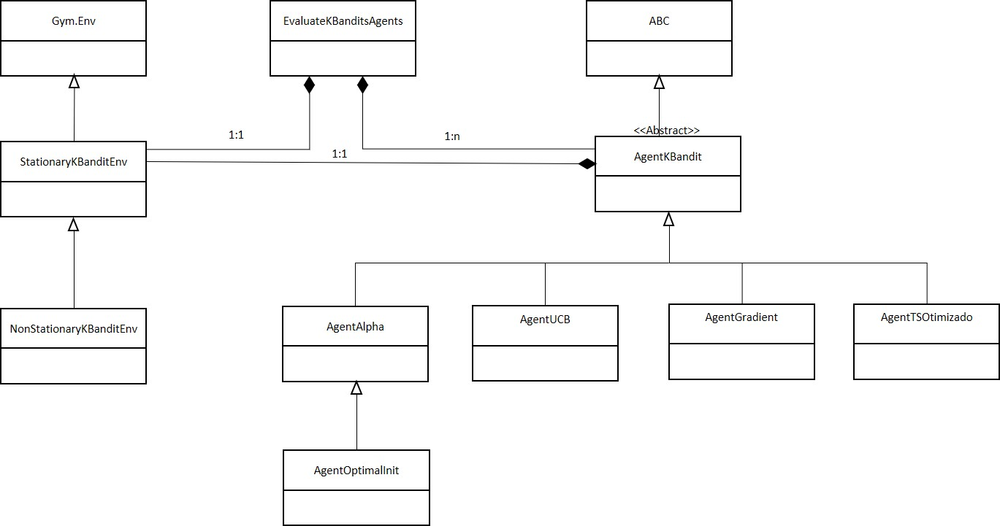

> **From Theory to Code: Implementing *K-Armed Bandits* with Design
> Patterns.**
>
> **Author:** Marco Aurélio Guimarães Falcão -- Systems Engineer
>
> **Date:** 10/08/2026 **Version:** English, Translated by Claude AI
> from Portuguese

1.  **Introduction**

> This article covers the Python implementation of solution algorithms
> for a classic Reinforcement Learning problem, the K-bandits problem
> described in Chapter 2 of the \[Sutton & Barto\] book \[1\]. This
> problem introduces the most basic concepts of Reinforcement Learning,
> such as: Environment, Agent, Actions, Policies, and Rewards. Book
> \[1\] also presents the main solution strategies for the K-bandits
> problem: Action-Value Estimation Method, Optimistic Initial Value,
> Upper Confidence Bound (UCB -- *Upper Confidence Bound*), and the
> Gradient Method.
>
> Chapter 1 of the \[Lattimore & Szepesvári\] book covers the concept of
> Regret as a widely used metric for measuring an agent\'s learning
> performance, comparing the use of the same algorithm across different
> environments. Section 36.1 of the same book covers the
> *Thompson-Sampling* (TS) solution strategy, an alternative with better
> performance but higher computational cost.
>
> The ***Strategy*** and the ***Template Method*** design patterns were
> used to implement the previously mentioned solution strategies. The
> former enables easy reuse of these solutions across various test
> cases, while the latter allows for abstraction and the use of a
> standardized interface, optimizing the implementation of the solution
> class hierarchy.
>
> Some examples from Chapter 2 of the \[Sutton & Barto\] book \[1\] were
> used as test cases to validate the Python implementation, yielding
> similar results for stationary environments. In addition, test cases
> for non-stationary environments were explored, such as Exercise 2.11
> of that book.

2.  **General Overview of RL (*Reinforcement Learning*) and Problem
    Definition.**

> Figure 1 presents the General Reinforcement Learning Scheme,
> illustrating the cyclical interaction between an Agent and an
> Environment. The Agent performs actions that impact the Environment;
> the Environment, in turn, reacts by providing observations --- which
> may indicate its internal state directly or indirectly --- and
> rewards, which serve as metrics of success or failure for the actions
> taken. The Agent processes this *feedback* over time, seeking to
> estimate the expected (or average) value of the reward for each
> action. Based on these estimates and the current state of the
> Environment, the Agent determines the next action to take, following a
> defined strategy or policy.
>
> Regret is the cumulative loss of reward suffered by the agent over
> time, resulting from choosing suboptimal actions instead of the action
> with the highest expected value (the optimal action).
>
> Intuitively, Reinforcement Learning can be compared to the process of
> training a puppy when it arrives at a new home. Initially, driven by
> exploration, the animal performs various random actions: chewing on
> chair legs, destroying socks, or relieving itself in inappropriate
> places. Learning occurs through the intervention of the owner, who
> acts as the mediator of rewards. For every desired behavior, the puppy
> receives a positive reinforcement (such as a treat); for every
> inconvenient action, it receives a negative reinforcement (such as a
> scolding). Over time and through repetition, the animal integrates
> this history of *feedback* and learns to select the actions that
> maximize its rewards, coming to understand the \'rules\' of the
> household environment.

**Figure 1 -- General Reinforcement Learning Scheme**

> The solution strategy for the Reinforcement Learning problem addresses
> \"How\" to choose the best action and is known as a Policy. A
> ***Greedy* strategy** always tries to choose the action with the
> highest average reward. This technique is called **exploitation**. To
> prevent the Agent from getting \'stuck\' with a merely reasonable
> choice, it is essential to allow for **exploration**: the practice of
> occasionally trying other actions with lower or unknown averages. An
> everyday example of this dilemma is the habit of always going to the
> same restaurant because you already know its value for money
> (exploitation) versus occasionally deciding to visit a new place to
> discover better flavors (exploration).
>
> Regret is the ideal metric for evaluating algorithms in simulation
> because it captures the cost of exploration more precisely than the
> raw reward. However, its calculation is infeasible in the real world,
> where we do not know the reward of the optimal action. As in life,
> regret is that feeling of trying a new restaurant and realizing you
> should have gone to your usual one.
>
> To gain an initial understanding of the problem, we turn to the
> etymology of *\'One-Armed Bandit\'* \[3\]. The term derives from the
> combination of *one-armed* (referring to the single lever that
> operates classic slot machines) and *bandit* (a thief who operates in
> lawless areas, or someone who deceives and cheats others). This
> metaphor reflects the fact that such machines are designed to \'rob\'
> players of their capital, who, statistically, lose to the house over
> time.
>
> The **K-Bandits** problem is a mathematical extension of the
> *\'One-Armed Bandit\'* dilemma to a scenario with K slot machines. In
> this model, an operator (or **Agent**) seeks to identify and select
> the machine\'s lever that provides the highest average return of
> rewards over time, as illustrated in Figure 2. The central challenge
> lies in the fact that the reward probability distributions of each
> machine are initially unknown, requiring the Agent to balance the
> exploration of new machines with the exploitation of those that have
> already shown good results. The K-bandits problem is also known in the
> literature as MAB (*Multi-Armed Bandits Problem*).
>
> When describing the Reinforcement Learning problem, it is essential to
> distinguish between the two types of environments considered:
> **Stationary** and **Non-Stationary** environment. In the stationary
> environment, the statistical properties of the rewards (such as the
> mean and standard deviation of the rewards of each arm) remain
> constant over time. In the non-stationary environment, these
> statistics change over time, requiring the agent to continuously adapt
> its estimates, dynamically changing and updating the Policy. This
> distinction is crucial, as it dictates the choice of update strategy
> and the weight given to more recent rewards.
>
> A Policy π defines how an action $a \in A$ should be chosen based on
> the observations obtained that define the state s of the Environment
> in question, as shown in Equation (1). In other words, the Policy is
> expressed as the set of probabilities of choosing action a, belonging
> to the set of possible actions *A* given that the environment is in
> state s.

  ---------------------------------------------------------------------
                       $$\pi = \ Prob(a \in A/s)$$              \(1\)
  -------------------- ---------------------------------------- -------

  ---------------------------------------------------------------------

{width="6.5in"
height="3.545138888888889in"}

The K-Bandits problem is considered the most accessible entry point into
Reinforcement Learning, as it is a single-state model. Unlike more
complex problems, here the environment does not change configuration
(does not change state) after an action; the focus lies on estimating
rewards and optimizing the choice policy. More sophisticated
environments require handling probabilistic state transitions, such as
Markov Decision Processes (MDPs), or consideration of cost or effort
constraints for performing an action, which are beyond the scope of this
text.

> Suppose the machine 3 out of the 10 machines in Figure 2 has the best
> average reward µ\* among all machines. The optimal policy π\* would be
> defined by the set of probabilities shown in (2). In other words, by
> always playing machine 3, the best average reward is obtained. The
> agent does not know which is the best machine, so it seeks to learn
> from the rewards which is the best strategy for choosing the action
> --- in this case, which machine to choose.

  ------------------------------------------------------------------------------------------------
                       $$\pi* = \ \lbrack 0,\ 0,\ 1,\ 0,\ 0,\ 0,\ 0,\ 0,\ 0,\ 0\rbrack$$   \(2\)
  -------------------- ------------------------------------------------------------------- -------

  ------------------------------------------------------------------------------------------------

> The K-bandits problem has several notable practical applications,
> including \[2\]\[4\]:

- Content Recommendation -- presentation of personalized movie artwork
  to each user by Netflix. The best artwork captures customers\'
  attention to watch movies or series \[5\];

- Adaptive A/B Testing -- choosing the best arrangement of graphical
  components (*Widgets*) on a web page that yields better results, i.e.,
  more purchases made by the customer;

- Clinical Trials -- drug dosing with lower ethical cost. Allows medical
  practitioners to try patient treatments with medications while
  observing their outcomes;

- Drone Networks -- trajectory optimization and resource allocation
  (power and battery) in rescue missions. In a disaster area where
  cellular network infrastructure has been destroyed, a drone can be
  used as a BRS (Base Radio Station) to establish communication with
  victims. In this case the bandits are a discrete number of possible
  directions the drone can take; for each direction, Rewards are
  measured in terms of better communication with victims, subject to
  constraints on battery consumption and transmission power cost. Due to
  these constraints, the number of possible directions is dynamically
  changed \[6\]; and

- Finance -- Dynamic selection of portfolios and *trading* strategies
  that quickly adapt to changes in market regime. For example, in a
  monthly investment strategy for new contributions or dividends,
  choosing which asset in the portfolio to invest in.

> This study was developed through a collaborative process with several
> Artificial Intelligences (AIs) using free resources, spanning from
> conceptual brainstorming and structuring the article to the writing,
> review, and correction of code, class architecture definition, image
> generation, and reference suggestions. It was deliberately decided not
> to use agent automation for the full, automatic generation of the
> text. Instead, the author orchestrated the construction of the content
> through iterative dialogues with different models, prioritizing two
> fundamental objectives: deepening technical knowledge of the
> Reinforcement Learning topic and exploring the capabilities and
> nuances of the AIs used themselves. Two approaches were used for this
> study: incremental construction (*Build-a-little Test-a-Little*) and
> *Human-in-the-Loop* for formulating questions and testing/validating
> the AIs\' responses. The specific AI tools employed are duly cited in
> the Conclusion.
>
> Python is used to implement the solutions. Being the predominant
> language in the AI field, it offers libraries that facilitate coding,
> such as the ***Gymnasium*** (or Gym) \[7\] package, which standardizes
> the interface between the agent and the environment. In addition, the
> use of **Google Colab** enables progressive and collaborative code
> development, offering GPU support and integration with the Gemini AI,
> ensuring greater agility in running the tests and experiments
> performed.

3.  **Solution Strategies:**

> The solution strategies are based on estimating the expected value of
> the rewards for each action (lever), as defined by the Sample Average
> (3).
>
> Let R~i~ be the reward obtained after the i-th activation of a given
> lever: The estimated value of the action, after it has been selected
> n-1 times, denoted by Q~n~, is calculated as the arithmetic mean of
> the rewards received, with i ranging from 1 to n-1

  ----------------------------------------------------------------------------------------
                       $$Q_{n} = \frac{R_{1} + R_{2} + ... + R_{n - 1}}{n - 1}$$   \(3\)
  -------------------- ----------------------------------------------------------- -------

  ----------------------------------------------------------------------------------------

> According to the Law of Large Numbers, as n increases, the estimate Qn
> converges to the true value of the lever\'s average reward q\*.

The recursive representation shown in Equation (4) is mathematically
equivalent to the arithmetic mean but more efficient for computational
implementation. It isolates the **estimation error** --- the difference
between the current reward and the previous average --- and scales it by
a step-size factor (1/n), allowing the estimate to converge
incrementally to the true value q\*.

  ----------------------------------------------------------------------------------------------------------
                       $$Q_{n + 1} = Q_{n} + \frac{1}{n}\left\lbrack R_{n} - Q_{n} \right\rbrack$$   \(4\)
  -------------------- ----------------------------------------------------------------------------- -------

  ----------------------------------------------------------------------------------------------------------

Equation (4) can be interpreted as an update rule based on the
estimation error, where the new value is adjusted from the previous
average plus a weighted increment. This increment, represented by the
term (R~n~ - Q~n~), is technically called the **prediction error** or
**innovation**.

The general structure of this update is expressed in Equation (5), in
which the variable weight 1/n is replaced by a constant step-size
parameter (or learning rate) $\alpha$.

  -----------------------------------------------------------------------------------------------------
                       $$Q_{n + 1} = Q_{n} + \alpha\left\lbrack R_{n} - Q_{n} \right\rbrack$$   \(5\)
  -------------------- ------------------------------------------------------------------------ -------

  -----------------------------------------------------------------------------------------------------

Once the estimates have been calculated using Equations (4) or (5), the
agent must select the next action to perform. The most common criterion
is the ***Greedy* Pure** method, in which the agent selects the option
with the highest current Action Value estimate. Formally, the action
selected at step t, denoted by A~t~, is defined as:

  ----------------------------------------------------------------------------------------------
                       $A_{t} = argmax_{(a \in A)}\left\lbrack Q_{t}(a) \right\rbrack$   \(6\)
  -------------------- ----------------------------------------------------------------- -------

  ----------------------------------------------------------------------------------------------

However, action value estimates are statistical variables that show
deviations from the true mean q\*. By the **Central Limit Theorem**, the
error of these estimates tends toward a normal distribution with mean 0
and standard deviation given by

$\frac{\sigma}{\sqrt{(n)}}$. Consequently, choosing the action with the
best current estimate does not guarantee the best long-term performance,
since the value of Q~t~(a) may be momentarily distorted by sampling
fluctuations.

To mitigate this risk, the **ε-Greedy** strategy is used. In this
method, the agent alternates between:

- **Exploitation (*Exploitation*):** With probability 1-ε, the action
  with the highest estimated value is selected.

- **Exploration (*Exploration*):** With probability ε, a random action
  is selected within the space $\mathcal{A\ }$ of actions, allowing the
  agent to refine its estimates for potentially underestimated actions.

Note that the Action Value for each bandit must start from an initial
value at instant 0, Q~0~. It is common to initialize Q~0~ to 0 for all K
bandits. However, there is a solution that initializes Q~0~ with higher,
equal values for all K bandits. This solution is known as **Optimistic
Initial Value**, and it uses the rule established by Equation (6) to
explore all K bandits right at the start of the algorithm.

This makes it possible to achieve better performance through a
systematic and complete exploration of all actions, which generally
speeds up the identification of the optimal action in **stationary**
problems, compared to the ***Greedy* Pure** method. However, since the
**ε-Greedy** method already has implicit exploration, **it is not
recommended** to use Optimistic Initial Value with it, as this
combination can saturate exploration and even worsen the solution\'s
performance.

In non-stationary environments, this technique loses effectiveness,
since the initial exploration proves insufficient to keep up with system
changes over time. In these scenarios, an improvement is observed when
adopting a higher constant step size, which allows the algorithm to
prioritize recent rewards over historical estimates. However, the
experiments carried out in this study reveal that this gain occurs only
in the initial steps, as detailed in the results section.

In this article, as in Chapter 2 of the Sutton & Barto book \[1\], the
rewards of the stationary environment for each Action at instant n, Rn,
are generated from normal distributions with unit variance, whose means
are, in turn, drawn from a standard normal distribution - $\mathcal{N}$
($\mathcal{N}$(0,1), 1); that is, the reward means for each bandit µ1,
µ2,\..., µk have zero mean and unit standard deviation, and the rewards
themselves have mean µi and unit standard deviation for each bandit i ∈
\[1, K\]. The expected values (true means) of reward for each arm, µ1,
µ2,.., µk, are initially sampled from a standard normal distribution
$\mathcal{N}$ (0, 1) and do not change afterward, so that the maximum of
µi, µ\*, given by Equation (7), already indicates the bandit that yields
the best average rewards, which is useful for evaluating the
algorithm\'s percentage of optimal choices.

  ------------------------------------------------------------------------------------------------------------------
                       $$\mu_{*} = max_{(a \in A)}\left\lbrack \mu_{1},\mu_{2},...,\mu_{k} \right\rbrack$$   \(7\)
  -------------------- ------------------------------------------------------------------------------------- -------

  ------------------------------------------------------------------------------------------------------------------

For the Non-Stationary environment, the means of the Normal
distributions used to draw and generate the rewards are modified at each
step by adding a deviation obtained from a Normal distribution *N*(0,
1), as in Equation (8).

  ----------------------------------------------------------------------------------------------------
                       $$\left\lbrack \mu_{1},\mu_{2},...,\mu_{k} \right\rbrack + = N(0,1)$$   \(8\)
  -------------------- ----------------------------------------------------------------------- -------

  ----------------------------------------------------------------------------------------------------

To calculate the percentage of optimal choice, the lever with the
highest initial mean is adopted as the reference, based on the system\'s
theoretical expectation. Since the perturbations added at each step
originate from zero-mean normal distributions, the long-term
mathematical expectation of the rewards remains unchanged, preserving
the identity of the original optimal lever. In this way, the metric
measures the algorithm\'s robustness in converging to the best
theoretical choice even under the accumulation of stochastic
fluctuations over time.

We have seen how the **ε-Greedy** method works, which can be considered
analogous to a **priority queue**. In it, priority is based on the
Action Value estimate (Q) for each lever, recalculated at each algorithm
step for the selected bandit. Occasionally, a \"judge\" draws lots among
all the arms to decide who should move to the front of the queue, based
on a fixed probability ε.

Thus, the exploration rule is based on the pair **(Q, ε)**, where Q is
the Action Value Estimate for each arm and ε is a fixed, generally small
value. The major limitation of this approach is that a promising lever
may, simply due to bad luck, take a long time to be selected again,
making exploration less effective and prone to neglecting potentially
optimal actions.

Continuing with the analogy, the **UCB (*Upper Confidence Bound*)**
method seeks to use additional information to define queue priority,
such as the elapsed time t -- equivalent to the number of algorithm
steps -- and the number of times each lever has been pulled, N. Thus,
the priority rule is established based on the tuple **(Q, t, N).** The
Central Limit Theorem establishes that the standard deviation with
respect to the mean estimate equals $\ \ \frac{\sigma}{\sqrt{N}}$ and
the confidence interval around the mean estimate corresponds to
$\pm c.\frac{\sigma}{\sqrt{N}}$ where c is a constant. The upper bound
of the confidence interval equals $Q + c.\ \ \frac{\sigma}{\sqrt{N}}$.
Starting from the fundamentals of probability bounds -- Hoeffding\'s
Inequality -- the UCB method establishes, through Equation (9), an upper
confidence bound for the action-value mean estimates for each lever,
increasing its chances of being selected the greater the elapsed time t
and the smaller the number of times it has been selected in the past,
Nt(a). It thus achieves better exploration of the levers, working around
the problem of a lever possibly being neglected in the **ε-Greedy
method.**

  ---------------------------------------------------------------------------------------------------------------------------------
                       $A_{t} = argmax_{(a \in A)}\left\lbrack Q_{t}(a) \right.+c.\sqrt{\frac{\log(t)}{N_{t}(a)}}\rbrack$   \(9\)
  -------------------- ---------------------------------------------------------------------------------------------------- -------

  ---------------------------------------------------------------------------------------------------------------------------------

**Note:** c = 1 or c = 2 are values typically used with Equation (9).

Figure 3 presents the Block Diagram of the Gradient Method. This method
is based on the search for an optimal policy π, which starts as a
uniform distribution (where all K bandits are equally likely) and is
updated each cycle based on an index known as H (Action Preference).
This update of preferences can be guided either by the deviation of the
Current Reward from the average of past rewards (with Baseline) or based
purely on the raw value of the Current Reward (without Baseline).
Finally, the vector H is mapped through the Softmax(H) function to
generate the new probability distribution of the policy π for the next
cycle.

{width="6.09375in"
height="2.9479166666666665in"}

**Note:** The hyperparameter of the Gradient Method is the learning rate
lr (*Learning Rate*).

Section 36.1, page 461, of reference \[2\] presents the solution
strategy for the K-armed bandits problem via *Thompson-Sampling* (TS).
TS is a probabilistic strategy for the K-bandits problem that estimates,
for each action, the mean and variance (or standard deviation)
parameters of the environment\'s reward distribution. Initially, prior
knowledge is assumed, assigning the same initial mean and standard
deviation values to all actions. At each step, values are sampled from
the prior distribution for each action, and the one that maximizes the
sampled value is selected. Upon pulling the chosen lever, a reward is
observed, which is then used to update the posterior distribution
parameters via Bayes\' Theorem. This updated distribution becomes the
new prior for the next step, and the process is repeated over the time
horizon. As a result, TS progressively converges to a good estimate of
the environment\'s true reward distributions.

The *Thompson Sampling* (TS) agent used in this article is based on the
use of normal distributions to model the belief about the average reward
of each action. This approach proved suitable for the scenarios
investigated, in which the environment also generates rewards from
normal distributions. Although TS with a normal prior performs
satisfactorily across a wide range of problems --- thanks to the
robustness of Bayesian updating and the Central Limit Theorem --- there
are situations in which other distributions are more appropriate.
Examples include the Beta-Bernoulli model for binary rewards, the Gamma
distribution for skewed positive rewards, the *Student*-Student
distribution for heavy tails, the Poisson distribution for count data,
and empirical or *bootstrap*-based approaches for unknown or multimodal
distributions. The choice of the appropriate distribution should
consider the nature of the observed rewards and the desired performance
for each application.

The estimated computational complexities for each algorithm (Table 1)
were consolidated from an analysis of the algorithms, based on the
structure of their decision and update loops (for example, ε-*greedy*
and UCB have O(1) operations per step, while the Gradient and *Thompson
Sampling* algorithms involve O(K) sweeps). This analysis was refined
during an in-depth discussion with an AI assistant (DeepSeek-V4-Flash,
2026) for the sake of clarity and comparison within the context of this
work.

  ------------------------------------------------------------------
        **Agents**        **Cost per Step**    **1000 steps x 2000
                                                      runs**
  ---------------------- -------------------- ----------------------
         ε-Greedy           O(1) -- simple        1 x (baseline)
                                update        

           UCB              O(1) -- simple            \~1.2x
                             calculation      

         Gradient        O(k) -- updates all  \~2-3x (depends on k)
                               actions        

      TS (original)        O(k+n) -- using           \~5-10x
                           np.var() on the    
                            history for n     
                          activations of the  
                                lever         

      TS (optimized)        O(k) - Welford            \~2-3x
  ------------------------------------------------------------------

  : **Table 1 - Cost Comparison of the Solution Strategies**

**Note:** The Welford solution for *Thompson Sampling* processes each
sample incrementally, instead of using all samples to calculate the
posterior variance.

As we will see in the Results section, *Thompson Sampling* (TS) shows
superior performance to most of the other solution strategies, both in
cumulative reward and in the optimal-action hit rate. This gain is
attributed to its ability to balance exploration and exploitation in an
inherently adaptive way. However, this benefit comes with a higher
computational cost, especially when implemented with more complex
distributions (such as Gamma, t-Student, or *bootstrap* (sampling with
replacement from a set of samples)), which require additional operations
per step. Nevertheless, in scenarios with a sufficiently long time
horizon or adequate computational resources, TS proves to be an
attractive and robust choice.

Although *Thompson Sampling* achieved the best performance in terms of
cumulative reward in most cases, UCB (*Upper Confidence Bound*) remains
a widely used alternative in practical applications due to its better
cost-benefit ratio. UCB combines near-optimal performance with
significantly lower computational cost, along with a simpler
implementation and less sensitive hyperparameter tuning. Furthermore,
UCB was able to outperform TS with an appropriately chosen
hyperparameter c.

4.  **Solution Evaluation Metrics:**

> Table 2 presents the metrics used to evaluate the test cases. This
> evaluation is done by interpreting the graphs generated in each run.
>
> To evaluate the algorithms\' performance from a multifaceted
> perspective, the experiments were analyzed using three complementary
> metrics, whose characteristics, requirements, and applicability are
> summarized in **Table 2**. While the average reward per step provides
> a relative gain index between approaches, the percentage of optimal
> choice evaluates the strict accuracy of the learning. In addition,
> cumulative *Regret* quantifies the cost arising from suboptimal
> decisions made over the time horizon, allowing the losses of each
> exploration policy to be evaluated.

+-------------------------+--------------------+--------------------+--------------------+
| **Metric Type**         | **Average Reward   | **% Optimal        | ***Regret*         |
|                         | per Step over a    | Choice**           | Accumulated**      |
|                         | Number of Runs**   |                    |                    |
+=========================+====================+====================+====================+
| **Best fit**            | Comparative        | Absolute result /  | Research /         |
|                         | analysis           | Immediate          | Fine-tuning of     |
|                         |                    | practicality       | algorithms /       |
|                         | Between methods in |                    |                    |
|                         | the same           |                    | Optimization       |
|                         | environment        |                    |                    |
+-------------------------+--------------------+--------------------+--------------------+
| **Knowing µ~\*~**       | Not required       | Yes                | Yes                |
|                         |                    |                    |                    |
| (requires prior         |                    |                    |                    |
| modeling/identification |                    |                    |                    |
| of the environment)     |                    |                    |                    |
+-------------------------+--------------------+--------------------+--------------------+
| **Comparison between    | Yes                | Yes                | Yes                |
| solution strategies for |                    |                    |                    |
| the same environment**  |                    |                    |                    |
+-------------------------+--------------------+--------------------+--------------------+
| **Comparison of the     | No                 | Yes                | Yes                |
| same solution strategy  |                    |                    |                    |
| across different        |                    |                    |                    |
| environments**          |                    |                    |                    |
+-------------------------+--------------------+--------------------+--------------------+
| **Shows the cost of the | Yes, inversely     | No                 | Yes                |
| error**                 |                    |                    |                    |
+-------------------------+--------------------+--------------------+--------------------+
| **Usage**               | Method A yields a  | Chose the optimal  | Lost 500 units     |
|                         | higher average     | action 90% of the  |                    |
|                         | reward per step    | time               |                    |
|                         | than method B      |                    |                    |
+-------------------------+--------------------+--------------------+--------------------+
| **Table 2 -- Solution Evaluation Metrics**                                             |
+----------------------------------------------------------------------------------------+

> **Note:** µ\* - the highest statistical average reward among the k
> levers, corresponding to the optimal choice.
>
> Let $R_{t}$ be the reward obtained by the agent at step $t$ (for
> $t = 1,2,\ldots,n$), where $n$ is the total number of steps (time
> horizon). The **Cumulative Average Reward** ${\overline{R}}_{T}$ is
> defined as the arithmetic mean of all rewards obtained up to step $T$:

  -----------------------------------------------------------------------------------------
                       $${\overline{R}}_{T} = \frac{1}{n}\sum_{t = 1}^{T}R_{t}$$   \(10\)
  -------------------- ----------------------------------------------------------- --------

  -----------------------------------------------------------------------------------------

> **The Percentage (%) of Optimal Choice** can be calculated by the
> ratio between the number of times the optimal bandit was chosen,
> N(Q\*), and the number of algorithm execution steps (num_steps).

  ------------------------------------------------------------------------------------
                       $$\%\_ Escolha\_ ótima = \frac{N(Q*)}{num\_ steps}$$   \(11\)
  -------------------- ------------------------------------------------------ --------

  ------------------------------------------------------------------------------------

> The **Regret** **Accumulated** after n steps is defined as the
> difference between the total reward that would be obtained by always
> selecting the optimal action (with mean µ\*) and the total reward
> actually obtained by the agent:

  ------------------------------------------------------------------------------------------------------------------------------------------------------------------------------------------
                       $$\mathbf{Regret}\left( \mathbf{n} \right)\mathbf{= n \cdot}\mathbf{\mu}_{\mathbf{*}}\mathbf{-}\sum_{\mathbf{t = 1}}^{\mathbf{n}}\mathbf{R}_{\mathbf{t}}$$   \(12\)
  -------------------- ------------------------------------------------------------------------------------------------------------------------------------------------------------ --------

  ------------------------------------------------------------------------------------------------------------------------------------------------------------------------------------------

> where:

- µ\* is the average reward of the best action (unknown to the agent),

- $R_{t}$ is the reward obtained at step t.

> This metric is widely used in the literature \[Lattimore & Szepesvári,
> 2020\] because it captures the cost of exploration more precisely than
> the raw reward, although its calculation is infeasible in the real
> world, where µ\* is unknown.

5.  **Architecture:**

> Figure 4 presents the Class Diagram used to run this article\'s test
> cases through the implementation of the K-Bandits environments
> (Stationary and Non-Stationary) and the Agents for different solution
> strategies (*Alpha -- Greedy* and *ε-Greedy*, UCB, *Gradient* and
> *Thompson Sampling* -- optimized TS).
>
> {width="6.0533366141732285in"
> height="3.1880610236220472in"}

**Figure 4-Class Diagram for the K-Bandits Implementation**

> The *Strategy* design pattern \[8\] gives the architecture flexibility
> by decoupling the control agent from the environment. This approach
> facilitates running multiple test scenarios and eliminates the need
> for complex conditional structures in the code.
>
> Applying the Template Method pattern \[8\] makes it possible to define
> a base abstract class for the K-Bandits agents, delegating the
> specific behavior to the specialized subclasses of each strategy. This
> structure preserves a unified calling interface, simplifying switching
> between different control agents.

6.  **Results:**

> Figure 5 illustrates the average reward rate and the percentage of
> optimal action choice for the $\epsilon$-greedy
> ($\epsilon \in \left\{ 0;0,01;0,1 \right\}$ agents with step size
> $\alpha = 1/n$) and for the *Thompson Sampling* (TS) agent optimized
> using the Welford method. The simulation was conducted in a stationary
> environment over $1.000$ steps and $2.000$ repetitions (*runs*). It is
> observed that the dynamics of the $\epsilon$-greedy agents corroborate
> the reference results \[1, Fig. 2.2\], while the optimized TS agent
> outperformed all other methods evaluated.

{width="6.5in"
height="2.6777777777777776in"}

> Figure 6 illustrates the average reward rate and the percentage of
> optimal action choice for the $\epsilon$-greedy agents subjected to
> different initializations --- with optimistic initial values
> ($Q_{1} = + 5,\epsilon = 0$) and realistic ones
> ($Q_{1} = 0,\epsilon = 0,1$), both with a constant step size
> $\alpha = 0,1$ --- compared to the Thompson Sampling (TS) agent
> optimized by the Welford method. The simulation was conducted in a
> stationary environment over $1.000$ steps and $2.000$ repetitions
> (*runs*). It is observed that the dynamics of the $\epsilon$-greedy
> agents corroborate the results described in \[1, Fig. 2.3\], while the
> optimized TS agent outperformed all other methods evaluated.
>
> .

{width="6.5in"
height="2.6777777777777776in"}

{width="6.5in"
height="2.6777777777777776in"}

Figure 7 illustrates the average reward rate and the percentage of
optimal action choice for the $\epsilon$-greedy agent ($\epsilon = 0,1$
with step size $\alpha = 1/n$), the UCB agent with exploration constant
$c = 2$, and the Thompson Sampling (TS) agent optimized by the Welford
method. The simulation was conducted in a stationary environment over
$1.000$ steps and $2.000$ repetitions (*runs*). It is observed that the
comparative behavior between the $\epsilon$-greedy and UCB agents
corroborates the reference results \[1, Fig. 2.4\], while the optimized
TS agent outperformed all other methods evaluated.

{width="6.5in"
height="2.6777777777777776in"}

Figure 8 illustrates the average reward rate and the percentage of
optimal action choice for the Gradient agents with and without baseline
(varying the Learning Rate $lr \in \left\{ 0,1;0,4 \right\}$, compared
to the Thompson Sampling (TS) agent optimized by the Welford method. The
simulation was conducted in a stationary environment over $1.000$ steps
and $2.000$ repetitions (*runs*). It is observed that the comparative
behavior between the Gradient agents corroborates the reference results
\[1, Fig. 2.5\], highlighting the crucial role of the baseline in
performance, while the optimized TS agent outperformed all other methods
evaluated.

> Figure 9 presents the same results obtained by Sutton & Barto \[1,
> Fig. 2.6\] for $1.000$ steps and $2.000$ repetitions (*runs*), varying
> the hyperparameters over a range of values for the various agents
> (with the exception of *Thompson Sampling*), which validates the
> application of these strategies in a stationary environment. The UCB
> algorithm achieved the best performance, reaching over 80% optimal
> choices for $c = 1$.

{width="5.452364391951006in"
height="3.2527777777777778in"}

{width="6.5in"
height="2.6777777777777776in"}

Figure 10 presents the comparison between the UCB agent ($c = 1$), the
$\varepsilon$-greedy agent ($\varepsilon = 0,1$), and the *Thompson
Sampling* agent for $1.000$ steps and $2.000$ repetitions (*runs*) in a
stationary environment. In this scenario, the UCB agent outperformed
*Thompson Sampling* in performance.

> As stated in the book \[1, Exercise 2.11\], results were obtained for
> all agents --- with the exception of *Thompson Sampling* --- varying
> the hyperparameters for the non-stationary environment scenario
> (Figure 11). Performance deteriorated for all agents tested. The UCB
> algorithm reached around 51% optimal choices for $c = 1/8$.

{width="5.71875in"
height="3.411111111111111in"}

Figure 12 presents the comparison between the UCB agent ($c = 1/8$), the
$\varepsilon$-greedy agent ($\varepsilon = 0,1$), and the *Thompson
Sampling* agent for $1.000$ steps and $2.000$ repetitions (*runs*) in a
non-stationary environment. In this scenario, the UCB agent outperformed
*Thompson Sampling* in performance.

{width="6.5in"
height="2.6777777777777776in"}

{width="6.5in"
height="2.6777777777777776in"}

Figure 13 presents the test case for varying
$\alpha \in \left\{ 0,01;0,1;\ 0,5 \right\}$ with ε fixed at 0.1 for the
non-stationary environment. It is noted that using a larger value of
$\alpha$ leads to better performance in the initial steps; however, the
result deteriorates as the effect of the environment\'s non-stationarity
accumulates with the increasing number of steps.

7.  **Conclusion:**

> The solution developed in Python was validated by comparing it with
> the results from the Sutton & Barto book \[1\] and can be used
> flexibly to evaluate the performance of the agents studied, in both
> stationary and non-stationary environments, across various other
> configurations.
>
> The UCB algorithm proved to be an excellent cost-benefit solution for
> the stationary environment scenario.
>
> All agents tested showed poor performance in non-stationary
> environments, indicating the need to employ techniques specific to
> this type of scenario, such as *Sliding-Window UCB*, *Discounted UCB*,
> and agents with adaptive memory. Reference \[2\] provides a more
> in-depth theoretical description of several solution techniques for
> the K-Bandits problem that were not covered in this article.
>
> We hereby acknowledge Google for providing the Google Colab
> environment with GPU access for editing, testing, and code analysis
> via integrated Gemini, as well as the Gemini and DeepSeek AIs for
> their valuable contributions to text review, definition of the
> *software* architecture, and the writing and correction of the Python
> code, and the discussion of results. We also thank the Claude AI for
> suggesting bibliographic references on real-world applications of the
> K-Armed Bandits problem (*Multi-Armed Bandits*).
>
> .

**References:**

\[1\] \[Sutton & Barto\] *Reinforcement Learning -- Second Edition* --
The MIT Press - Chapter 2 - 2018

\[2\] \[Lattimore & Szepesvári\] *Bandit Algorithms* -- Free Edition --
Cambridge Press - 2020

\[3\] One-armed Bandit, Wiktionary,
<https://en.wiktionary.org/wiki/one-armed_bandit>, accessed on
29/04/2026.

\[4\] \[Bouneffouf & Rish\] *A Survey on Practical Applications of
Multi-Armed and Contextual Bandits* 02/04/2019

\[5\] *Artwork Personalization at Netflix, Netflix Blog*,
<https://netflixtechblog.com/artwork-personalization-c589f074ad76>,
07/12/2017, accessed on 30/04/26

\[6\] \[Amrallah, Mohamed, Tran & Sakagushi\], MDPI, *UAV Trajectory
Optimization in a Post-Disaster Area Using Dual-Energy-Aware Bandits*

\[7\] \[Lapam\] *Deep Reinforcement Learning Hands-On* -*Third Edition*
-- Chapter 2 - 2024

\[8\] \[Gamma, Helm, Johnson, Vlissides\] *Design Patterns, Elements of
Reusable Object-Oriented Software* -- Pages 315 and 325 -- 1994

\[9\] GitHub -- GitHub -
https://github.com/kwahcarioca/Reinforcement-Learning/tree/main/K-bandidos/notebooks
